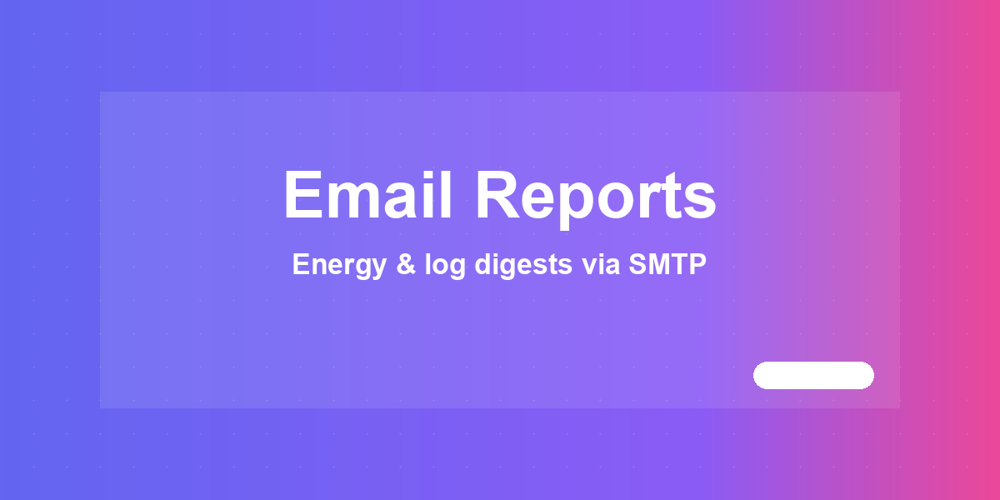
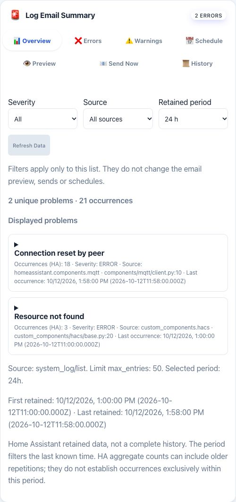
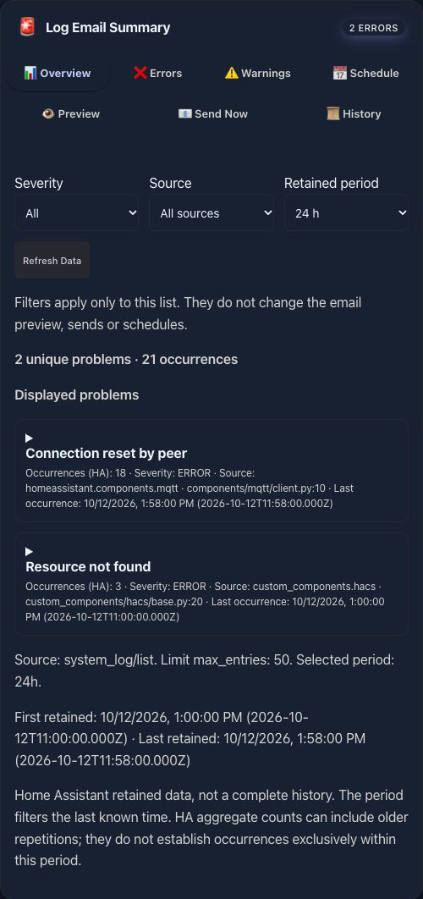
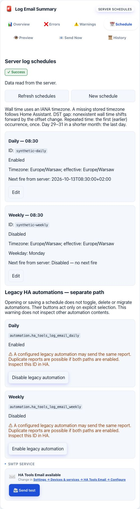
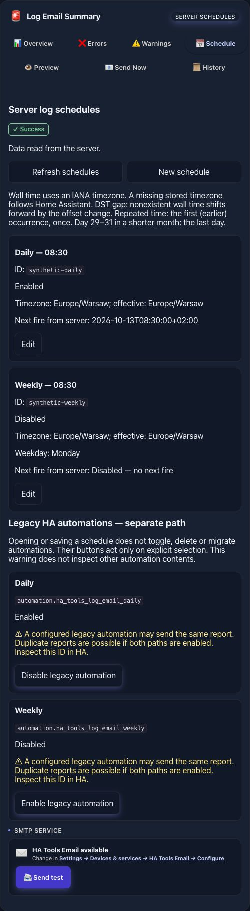
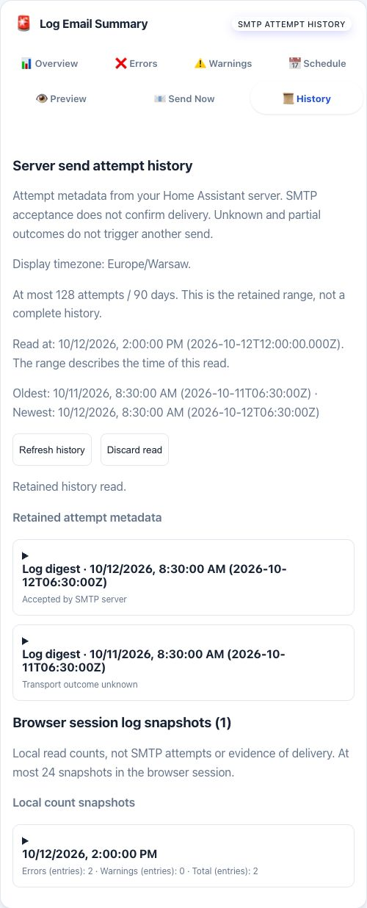
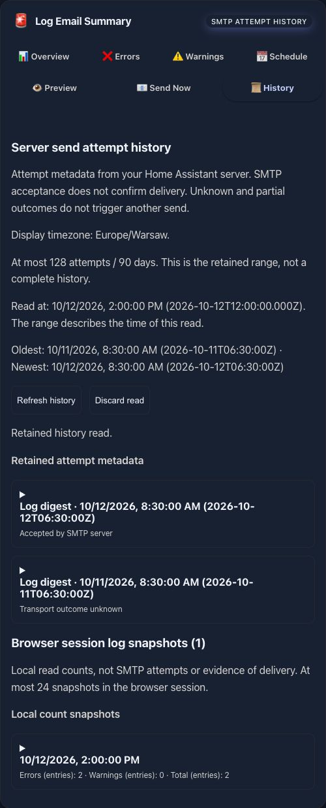

# 📧 HA Tools — Email & Reports



Error/warning log-digest emails and a Recorder-backed dashboard report in one
HACS plugin. The log card sends through the separate **HA Tools Email**
integration; Smart Reports reads Home Assistant Energy/Recorder data and does
not send email.

> **Energy Email moved to Energy Optimizer (4.5.0).** `custom:ha-energy-email`
> is now maintained in [Energy Optimizer](https://github.com/MacSiem/ha-energy-optimizer)
> (HACS default catalog). This plugin keeps a thin wrapper so existing cards
> keep working: with Energy Optimizer installed they render its card; without
> it they show how to install it. No dashboard changes are needed.

[](https://www.home-assistant.io/) [](https://github.com/MacSiem/ha-tools-email-reports/releases) [](LICENSE)

Part of the [HA Tools](https://github.com/MacSiem) ecosystem.

Version 4.6.1 immediately clears accepted Smart measurements and device details when the HA user, connection or timezone changes, including disconnection. Locale and theme changes retain current measurements.

The generated bundle includes the exact Smart Reports 4.2.0 source. With both repositories installed, either load order provides the same current report behavior; no extra standalone import is required to update the bundled card. Both resources must contain the same Smart version: an older bundle can register the card before a newer standalone file. Update both products or retain one Smart-providing resource, then reload the browser.

## How it works

This plugin ships one Lovelace resource (`ha-tools-email-reports.js`) — a
single-file bundle that contains the log and Smart Reports cards plus the
Energy Email wrapper (the individual
`ha-energy-email.js` / `ha-log-email.js` / `ha-smart-reports.js` files are
kept in the repo for development only). There is **no
`custom:ha-tools-email-reports` card type**; add the individual cards you
want by their own tag:

1. **`ha-energy-email`** — compatibility wrapper only. The card itself is
   provided by [Energy Optimizer](https://github.com/MacSiem/ha-energy-optimizer);
   install it from HACS to use energy-usage emails.
2. **`ha-log-email`** — previews and sends daily, weekly and monthly digests
   of retained `system_log` errors and warnings, with a configurable entry limit and a
   history tab. Logs and report controls are available to administrators only;
   household users see an explanation without reading logs or SMTP settings.
3. **`ha-smart-reports`** — an on-demand energy / automations / system-health
   report. Energy periods use exact Recorder `change` statistics declared by
   Home Assistant Energy (or explicit statistic IDs); Automations and System
   remain current-state operational summaries. It **does not** send email and
   does not need the integration below.

**`ha-log-email` (and Energy Optimizer's `ha-energy-email`) require the separate [HA Tools
Email](https://github.com/MacSiem/ha-tools-email-integration) integration**
(`ha_tools_email` domain). Detection is a client-side check for
`hass.services.ha_tools_email.send`; if it's missing, the card shows an
inline "This tool requires the HA Tools Email integration" banner with an
install link instead of failing silently. Once the integration is installed
and SMTP is configured in the integration's own settings, all email leaves through that backend. Compatible report controls use WebSocket commands for backend-composed manual sends, schedules, previews and bounded attempt history; the existing service remains available for SMTP tests and custom automations. They never open an SMTP connection.

### Server schedules and existing automations

With **HA Tools Email 2.2.0 or newer**, the Schedule tab manages server-side daily, weekly and monthly log digests. Choose a wall time, weekday or month day, and an optional IANA timezone. An empty timezone follows Home Assistant. New schedules start disabled; opening the tab, editing a draft, cancelling or previewing sends nothing and saves nothing. Saving requires administrator access and a separate matching server readback before showing Success. If the outcome is unconfirmed, refresh to check it before trying another write.

Calendar support is confirmed from the loaded integration manifest before writes. Backend 2.1.2 supports basic email but silently drops the new calendar fields, so the new schedule editor remains unavailable until the backend is updated. Refresh after updating. DST gaps move forward by the offset change; a repeated wall time runs at its first occurrence, once. A month day of 29–31 uses the last day in a shorter month.

Preview reads the previous completed calendar day, week or month in the selected timezone directly from the backend. It shows the actual range and retained-log limitations, without SMTP delivery or history/digest writes. It is separate from the explicit manual period selection below. Backend2.2 returns a summary;2.3+ can return the actual composed mail.

Existing `automation.ha_tools_log_email_daily` and `automation.ha_tools_log_email_weekly` controls remain available. They are independent of server schedules: review them to avoid duplicate emails. The card does not create or rewrite those automations. An existing automation calling `ha_tools_email.send` must provide its own subject and body. Energy Email scheduling belongs to Energy Optimizer.

### Retained logs and attempt history

Severity, source and 24-hour / 7-day / 30-day filters apply only to the displayed retained logs; they do not change email content or a saved schedule. A stable backend identity groups repeated aggregates without counting a duplicated row twice. Unique problems and HA occurrence counts are shown separately. The entry limit, observed range and data source remain visible. HA aggregate counts may include older repetitions, and filtering the last observed time does not establish how many occurrences happened exclusively in that window. The fallback sensor is only a current snapshot.

History separates bounded server SMTP attempts from browser-local count snapshots. Refresh explicitly reads attempt metadata; timestamps, kind, period, entry count and outcome are shown without mail addresses, subjects, bodies or raw errors. SMTP acceptance does not establish inbox delivery. Server retention is at most 128 attempts / 90 days. Local snapshots describe this browser and account, not server delivery history.

### Actual mail preview and manual sends (4.7+)

Install **stable HA Tools Email 2.3.0 or newer** before using the new manual
preview or send controls. Preview selects daily, weekly or monthly and either
rolling 24-hour / 7-day / 30-day retained windows or the previous completed local
day / ISO week / calendar month. The backend chooses the actual inclusive start
and exclusive end; the card shows those dates with their timezone and source.
Calendar periods follow the Home Assistant timezone. The Send tab shares the
same period mode and offers a separate button for each cadence.

The preview shows the actual subject and HTML composed by the server, isolated
in a sandboxed frame with scripts, external resources and form actions blocked.
Reading it does not send mail or change schedules/history. A later send composes
again from current data, so new log records can change its contents. An older
backend shows an update explanation instead of silently sending a browser-built
report. SMTP server acceptance remains distinct from inbox delivery.

Manual reports use server-retained data, independently from this browser's list
filters, fallback sensor, latest refresh or scheduled digest state. They do not
advance the scheduled digest's last-seen keys. Future or missing timestamps are
excluded. Retention and `max_entries` (1–1000, per severity list) can limit the
report; aggregate counts are not exact events or complete historical coverage.

The source code and README on this working branch describe the4.7 candidate;
public4.6.1 remains the prior release until a new release is published.

### What is automatic vs. manual

| Automatic | Manual (optional) |
|---|---|
| Home Assistant Energy source mapping (`ha-smart-reports`) | Setting SMTP server/recipient once, in the HA Tools Email integration |
| Integration-presence detection + install banner | Choosing server calendar schedules (backend 2.2+); reviewing existing automation paths to avoid duplicates |
| Error/warning digest from `system_log` (`ha-log-email`) | Choosing log filters and manual sends; configuring a tariff and currency only for energy reports |
| Automation/system operational summary (`ha-smart-reports`) | Selecting explicit Smart Reports total/device/cost statistic roles |
| Recorder-backed local-calendar energy periods (`ha-smart-reports`) | Reviewing and saving Smart Reports JSON / CSV locally |

## Screenshots

| Light | Dark |
|---|---|
|  |  |
|  |  |
|  |  |

*Historical 4.6.0 overview/schedule/history UI rendered with synthetic data at a 500 px card width. The
read-only screenshot harness has no Home Assistant or SMTP connection. Logs
show two unique problems and 21 retained HA occurrences; schedules show a
server next-fire time and separate legacy controls. SMTP acceptance is not
inbox delivery. No real address, log entry or household data is shown.*

## Compatibility

The Dashboard bundle requires Home Assistant Core **2024.5.0 or newer**. Log Email uses the frontend service-response API to read the centrally configured recipient; the frontend shipped with Core 2024.1.0 ignores that response argument. Core 2024.5.0 ships frontend 20240501.0 with support for it. These floors are qualified against the official Core/frontend contracts; an old Home Assistant instance was not run for this maintenance release.

Basic manual Log or Energy email requires the separate **HA Tools Email 2.1.2 or newer** integration. Server calendar schedules, calendar previews, attempt history and shared tariffs require **2.2.0 or newer**. The backend requires Core **2024.7.0 or newer**. Smart Reports works without SMTP. Energy Email is provided by Energy Optimizer and retains that product's compatibility requirements.

## Installation

### HACS (custom repository)

1. Open HACS → Frontend (Dashboard) → ⋮ → **Custom repositories**.
2. Add `https://github.com/MacSiem/ha-tools-email-reports` with category
   **Dashboard** (Lovelace plugin).
3. Install **HA Tools — Email & Reports** and reload your browser. HACS
   delivers a single file (`ha-tools-email-reports.js`) — nothing else to
   download. For `ha-energy-email`, also install **Energy Optimizer** from the
   HACS default catalog.
4. If you want `ha-log-email` (or Energy Optimizer's `ha-energy-email`), also add
   `https://github.com/MacSiem/ha-tools-email-integration` with category
   **Integration**, install it, and restart Home Assistant.
   `ha-smart-reports` works without this step.

### Manual

1. Download `ha-tools-email-reports.js` (the bundle)
   from the [latest
   release](https://github.com/MacSiem/ha-tools-email-reports/releases).
2. Copy it to `/config/www/community/ha-tools-email-reports/`.
3. Add `/local/community/ha-tools-email-reports/ha-tools-email-reports.js`
   as a Lovelace resource (type: `module`).

## Quick start

```yaml
type: custom:ha-log-email
```

Smart Reports is added the same way:

```yaml
type: custom:ha-smart-reports
```

The minimal Smart Reports configuration uses the Home Assistant Energy
Dashboard preferences. It does not auto-detect energy entities from names or
fall back to current entity states. If no grid import statistic is configured,
the card shows a configuration state.

Use explicit roles when the report should use a different exact set:

```yaml
type: custom:ha-smart-reports
energy_source_mode: explicit
energy_total_statistics:
  - sensor.grid_import_energy
energy_device_statistics:
  - statistic_id: sensor.heat_pump_energy
    label: Heat pump
  - statistic_id: sensor.heat_pump_indoor_energy
    label: Indoor unit
    included_in_stat: sensor.heat_pump_energy
energy_cost_statistics:
  - sensor.grid_import_cost
```

Headline totals include only root total sources. Devices never increase the
headline, and included children are nested rather than ranked twice. Cost
statistics are labeled as actual cost and must use the exact currency from
Home Assistant configuration. Without them, a flat estimate requires
both an explicit finite `energy_price >= 0` and a `currency`; Smart Reports
has no default tariff.

Today / 7 days / 30 days are local-calendar windows in Home Assistant's
configured timezone. Missing, invalid, unsupported or incomplete required
statistics are surfaced with per-source status/reason evidence and combined
totals/cost are withheld. The export dialog previews filename, format, included and excluded fields before Save. JSON uses schema 2, or schema 3 for previous-period comparison, and includes both selected ranges and full device snapshot regardless of search. CSV preserves available status and provenance; CSV neutralizes formula-leading labels. Private fields default off. The visual
editor exposes safe Title and Currency fields, tab selection is per card
instance, and disabling every section performs no Home Assistant requests.

Energy Email options are documented in the
[Energy Optimizer README](https://github.com/MacSiem/ha-energy-optimizer).

## FAQ

**Do I have to configure anything?**
`ha-smart-reports` does not need the email integration, but its default Energy
view expects a configured Home Assistant Energy grid-import statistic. It can
instead use explicit statistic roles as shown above. `ha-log-email` needs the HA Tools Email integration and its SMTP settings saved
once.

**What happens if the HA Tools Email integration isn't installed?**
`ha-log-email` shows an inline banner explaining the
integration is required and linking to it — it doesn't fail silently or send
through your `notify:` platform instead.

**Does scheduled sending require a browser tab to stay open?**
No. Server schedules in HA Tools Email 2.2+ run inside Home Assistant. Existing standalone automations also run without a browser, independently of those schedules. Review both paths to avoid duplicate sends. Opening the dashboard does not create an additional scheduler. Energy Email is maintained by Energy Optimizer.

**Where do the emails actually go out through?**
Your own SMTP server, configured once in the HA Tools Email integration.
This plugin's cards never talk to any mail server directly — they use Home Assistant services and the integration's WebSocket commands.

**Does this send data anywhere else, or use any CDN?**
No. There are no `fetch`/`XMLHttpRequest` calls in the card runtime. The cards
use Home Assistant's same-origin APIs and state objects; optional donation and
installation links open only when clicked. There is no telemetry, analytics,
remote font, CDN or panel/discovery runtime dependency.

## Smart Reports source and bundle parity

`ha-smart-reports.js` is a vendored, byte-identical copy of the standalone
Smart Reports runtime. `generated-sources.json` pins owner, path, version and
SHA-256 provenance for all three inputs, and `scripts/build-bundle.mjs --check`
validates the complete manifest before deterministically verifying that each
developer source appears exactly once in
`ha-tools-email-reports.js`. CI does not depend on a sibling repository;
cross-repository comparison is an additional maintainer gate.

## Changelog

See [CHANGELOG.md](CHANGELOG.md).

## Support

If this tool makes your Home Assistant life easier, consider supporting
development:

- [☕ Buy Me a Coffee](https://buymeacoffee.com/macsiem)
- [💳 PayPal](https://www.paypal.com/donate/?hosted_button_id=Y967H4PLRBN8W)

The optional support link in Log Email and Smart Reports is shown only to administrators. Dismiss it in the card or set `show_support: false` in the card configuration.

## License

MIT — see [LICENSE](LICENSE).

## Privacy and data

The cards read Home Assistant logs and configured energy statistics. Reports and logs can reveal household activity, entity identifiers and error details. Sending through HA Tools Email transmits the selected content to your configured SMTP destination. Review recipients and content, and redact exports before sharing.

See [SECURITY.md](SECURITY.md) for safe vulnerability reporting and [NOTICE](NOTICE) for licensing notices.

Smart Reports energy ranges end at the last completed Recorder UTC hour. Missing boundary hours or buckets extending beyond the range withhold the total and estimated cost. Before the first completed hour, Today has an empty range and no data, including timezones with fractional-hour offsets. The exported range matches the report exactly.
